# Fetishes and talens

A fetish is an item with a spirit bound into it. A talen holds a spirit for one use.

## Fetishes

Each fetish has a level and a Gnosis rating, shown on the item.

### Attuning

Right-click the fetish with a Garou and pick **Attune**. The Garou sits with it for an hour, pays a
point of Gnosis and rolls Gnosis against its rating. One success is enough. A weapon goes into
the hand, anything else into the inventory.

- Only a Garou can wake the spirit in it.
- A fetish serves one Garou at a time. Attuning it takes it from whoever had it.
- On a failure the spirit sulks and won't listen until tomorrow.
- The labrys won't serve a man.

### Using one

While its Garou carries it (in hand, in the inventory, worn, or held through a form), the spirit
is awake: it gives what it always gives, and a button for each power. Each power is woken with a
point of Gnosis when the Garou has one, or a Gnosis roll at the fetish's rating when they don't.
Put down, or in anyone else's hands, the fetish sleeps.

A spirit woken in a frenzy, or turned on someone who isn't hostile, takes offence and won't
answer for three days.

The klaive, the grand klaive and the Jarlhammer are silver. A klaive costs its Garou a die of
Gnosis, a grand klaive two.

### Tainted fetishes

A fetish the Wyrm has bent can't be attuned or woken, and fouls the ground around it about once
a day while it's kept on the map. The Rite of Cleansing makes it an ordinary fetish again.

## Talens

A talen needs no attuning. Use it from the inventory or the ground: a Gnosis roll at its rating,
then it's gone. Bane arrows fly at the nearest hostile spirit and the moon sign at the nearest
Garou; the rest work on the user.

## Getting them

- **The Fetish choice** in the making menu: one fetish up to level 2, level 1 for a cub, attuned
  from the start.
- **Septs** sell a few, and buy them back, and sometimes pay for a mission with one.
- **The Wyrm**: Pentex plants and Black Spiral Dancers carry tainted ones.
- **Making them**, with the Rite of the Fetish or the Rite of Binding.

## Making them

Both rites need a spirit of the item's kind within 8 cells of the ritemaster, willing to go in,
and the vessel beside them. A spirit is willing once its [chiminage](The-Umbra-and-Spirits.md#talking-and-chiminage)
is paid or a Gift has befriended it. A bane doesn't bargain: it goes in calmed or beaten down.
The vessels are ordinary materials, named on the item's page.

- **The Rite of the Fetish** (level 3) makes one fetish, of any level up to the ritemaster's rank.
- **The Rite of Binding** (level 1) makes a talen for each success, up to three.

## Every fetish

| | Fetish | What it is |
|---|---|---|
| 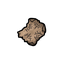 | **Apeskin** | A scrap of tattooed skin with a Homid ancestor bound in it. Woken, it lets its Garou live a day as one born human: silver is no worse than steel, but the wounds don't knit by themselves either. |
| 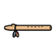 | **Harmony flute** | A hickory flute hung with songbird feathers. Its tune calls up memories of a whole world, and every angry creature that hears it stops fighting. |
| 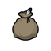 | **Magpie's swag** | A plain sack with a magpie spirit bound in it. It holds three times what it looks like it should. |
|  | **Mirrorshades** | Mirrored sunglasses with a glass elemental bound in them. A mirror always to hand: the Gauntlet is two lower to step sideways. |
|  | **Nyx's bangle** | A silver bracelet carved with glyphs to Luna and a night spirit bound in it. Woken, it hides its Garou in the shadows; only the eyes shine. |
|  | **Truth earring** | A small gold earring with a servant of Falcon in it. It trembles at every lie its wearer hears. |
| 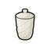 | **Cup of the alicorn** | A carved, covered cup said to be unicorn horn. Any poison poured into it turns harmless. |
| 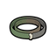 | **Chameleon skin** | A belt of lizard hide with a chameleon spirit bound in it. Woken, the Garou's fur takes the colors of the land around. |
| 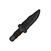 | **Dagger of retribution** | An ugly iron dagger with a vengeance spirit in it. Held and woken, it tugs toward whoever wronged its Garou. |
|  | **Dream stealer** | A many-colored gem with a dream spirit in it. Held near a sleeper and woken, it plays their dreams in its depths. |
| 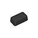 | **Spirit tracer** | A human hair set in an iron ingot with a predator spirit bound in it. Woken, the ingot pulls toward spirits. |
| 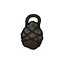 | **Baneskin** | A scrap of a bane wrapped in cloth and worn as an amulet. Woken, it makes the banes around take its Garou for one of their own. |
| 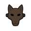 | **Beast mask** | A carved wolf mask with an animal spirit bound in it. Woken, it pulls its Garou into the wolf's shape and holds them there for an hour. |
| 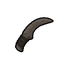 | **D'siah** | A flint knife curved like a crescent moon, with a cobra spirit in the blade: the Silent Striders' own. Its cuts are aggravated, and woken after a strike it drinks the foe's Gnosis. |
| 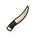 | **Fang dagger** | A dagger carved from a great beast's tusk, with a snake spirit in it. Woken after a strike, it bites deeper into the wound. |
|  | **Partridge wing** | A snow-white partridge wing on a gold chain, with a spirit of forgetting in it. Swept around someone in a circle, it sweeps away a memory, and with it their fear. |
|  | **Phoebe's veil** | A small gold half-moon pendant with a lune bound in it. Woken at night, its wearer vanishes from every sense but touch, a minute a success. |
| 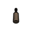 | **Sanctuary chimes** | A tiny tubular bell with a turtle spirit in it. Rung, its chimes keep hostile spirits away for a day. |
| 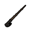 | **Sun whip** | A bullwhip woven with gold nuggets, with a spirit of flame bound in it. Woken, it bursts into fire against whatever it strikes. |
| 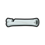 | **Wind whistle** | A whistle of bone with a wind elemental in it. One long blast calls a freezing, snow-laced wind on the Garou's pursuers. |
| 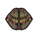 | **Feathered cloak** | A full-length cloak of a thousand colored feathers with a bird spirit bound in it. Woken, it carries its wearer through the air. |
| 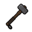 | **Ironhammer** | A one-handed hammer of silver-laced iron with a war spirit in it: the Get of Fenris's own. Its blows are aggravated, and thrown it flies back to its Garou. |
| 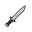 | **Klaive** | A silver dagger with a war spirit bound in it, the signature weapon of the Garou. Its cuts are silver: no Garou soaks them. Carrying one dulls its Garou's Gnosis by one. |
| 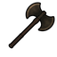 | **Labrys of Isthmene** | A massive double-headed axe dedicated to Isthmene, the Gorgon of battle: the Black Furies' own. Its blows are aggravated, and woken it grants the Spirit of the Fray. It answers no male. |
| 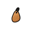 | **Monkey puzzle** | An amber talisman holding one human hair, with a trickster spirit bound in it. Woken, people see an ordinary person, whatever form the Garou wears. |
| 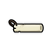 | **Spirit whistle** | An ivory whistle with a screech-owl spirit in it. Its wail tears at every spirit in sight. |
| 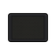 | **Personal Umbral Digital Application** | A tablet with a bee spirit in its circuits: the Glass Walkers' own. Its hive of files keeps the Garou's notes and research in perfect order. |
|  | **Unbroken cord** | A length of braided hemp cord with a flock spirit in it, enough for a whole pack. Woken, its Garou shares Gnosis with every packmate near. |
| 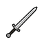 | **Grand klaive** | An immense silver sword with a war spirit and a fire spirit bound in it: the klaive of a legendary hero. Its cuts are silver, and woken the fire spirit shields its Garou from flame. Carrying one dulls its Garou's Gnosis by two. |
| 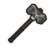 | **Jarlhammer** | One of the seven great hammers of the Get of Fenris, silver-laced iron with spirits of war and silver in it. Its blows are silver, and woken it blazes with fire. |
| 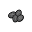 | **Runestones** | Carved divination stones with a spirit of time bound in them. Cast and woken, they show what is to come. |

## Every talen

| | Talen | What it is |
|---|---|---|
| 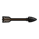 | **Bane arrow** | An obsidian-headed arrow with a war spirit in it. Woken, it flies at the nearest hostile spirit and never misses. |
| 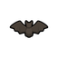 | **Chiropteran spy** | A wooden bat figurine with a bat spirit in it. Woken, it flies off to scout and shows every foe on the map before it turns to sawdust. |
| 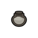 | **Death dust** | A small jar of dust with a spirit of death in it. Sprinkled on the newly dead, it lets them speak: what they knew is the Garou's. |
| 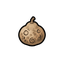 | **Gaia's breath** | A dried, glyph-painted gourd with a healing spirit in it. Crushed over a wound, it heals even aggravated wounds. |
| 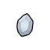 | **Moon glow** | A moonbeam caught in a crystal by a lune. Woken, it keeps its Garou safe on a journey through the spirit world: spirits ask no price and leave them be. |
| 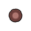 | **Moon sign** | A wax seal with the sign of the full moon and a lune in it. Thrown down before a Garou, it forces them into Lupus. |
| 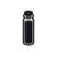 | **Nightshade** | A vial of night distilled. Drunk, it turns its drinker to shadow for an hour. |
| 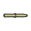 | **Wind snorkel** | A hollow reed with an air elemental in it. Through it, its Garou breathes anywhere: under water, in smoke or in poison. |
| 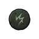 | **Wyrm scale** | A sigil with a captive Wyrm spirit in it. Woken, every servant of the Wyrm on the map shows its true form; then it burns up in green fire. |

[← Contents](README.md)

---

This is not official World of Darkness material. Portions of the materials are the copyrights
and trademarks of Paradox Interactive AB, and are used with permission. All rights reserved. For
more information please visit worldofdarkness.com.
